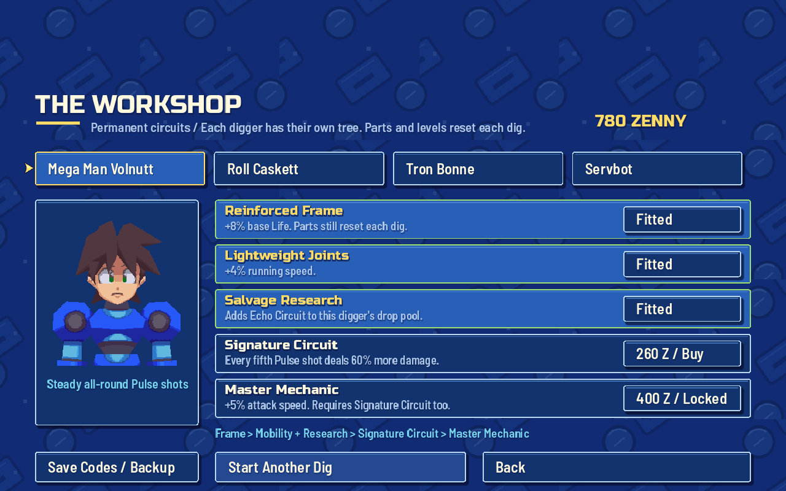
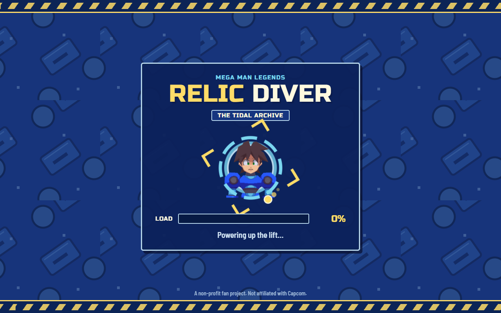
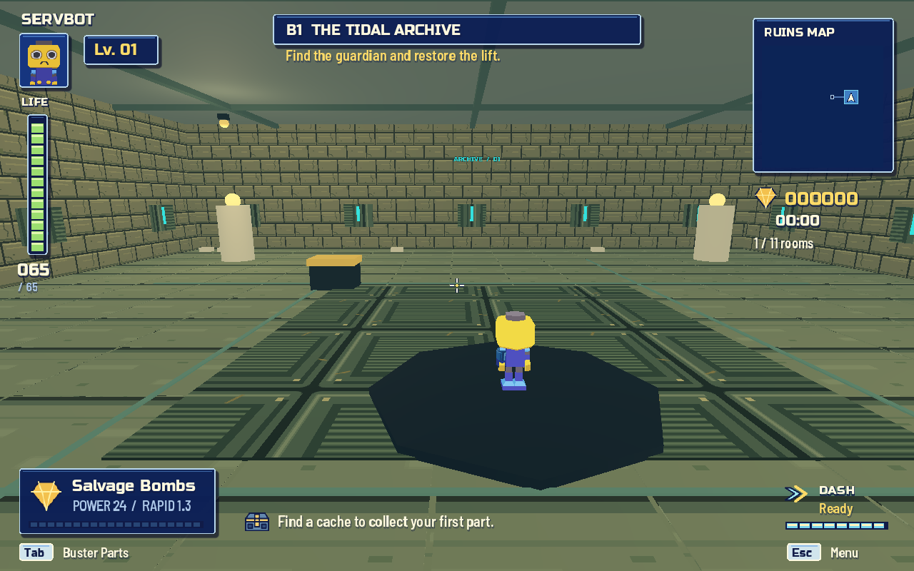
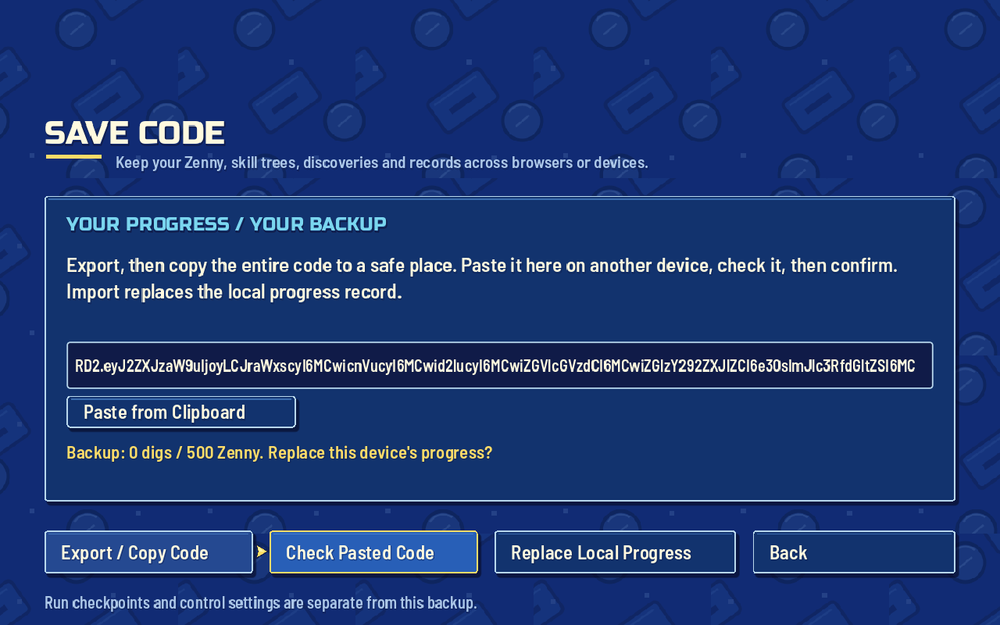

# Next-features implementation report

Branch: `codex/next-features-volnutt`, based on `main` at `9c4d309`. Prepared October 13, 2026. The live site was not redeployed; merge and deploy when ready.

## What changed

| Digger | Signature attack | Character identity / signature-tree ability |
|---|---|---|
| Mega | Pulse Buster | All-rounder; purchased circuit strengthens every fifth shot |
| Roll | Rapid Needle Buster | Revives teammates twice as fast; purchased circuit repairs 8 Life when dashing, on an 8-second cooldown |
| Tron | Heavy Siege Buster | Cover-aware splash; purchased circuit expands its radius |
| Servbot | Ballistic salvage bombs | 65 starting Life, 18% faster movement, smaller capsule and lower camera; purchased circuit expands its blast radius |

The Workshop has five prerequisite-gated nodes per character, with separate purchases and a shared personal Zenny wallet. Rewards combine depth, defeated guardians and leftover scrap. Trees add signature abilities, early part access and modest Life/movement/attack-speed bonuses. Costs and effects are centralized in `scripts/progression.gd`. Parts and run upgrades still reset.

New players unlock the existing advanced parts at 40, 100 and 220 lifetime machines. Migrated profiles retain every previously earned part. Purchases save immediately; skills and attack state travel through co-op builds and checkpoints.

Save Codes exports records, discoveries, Zenny and all trees. Imports validate the version, checksum, types, bounds and prerequisites before presenting a replacement confirmation. Invalid codes cannot change the current profile. Import is blocked during a dig, online lobby or unresolved saved dig. Atomic writes and an explicit browser filesystem sync protect the updated record. A checksummed, revisioned localStorage mirror is written synchronously and recovered at startup when it is newer, covering an interrupted IndexedDB write. The browser test waits for the actual IndexedDB commit before reloading; browser storage commits are asynchronous. Godot documents the sync request in [JavaScriptBridge](https://docs.godotengine.org/en/4.7/classes/class_javascriptbridge.html#class-javascriptbridge-method-force-fs-sync).

Options now switches between whole-floor and scrolling local maps. The loading illustration and project/browser icons use the supplied Volnutt model portrait, retaining Capcom attribution. Both web packagers include the image assets and explicit favicon links. Browser text fields retain focus across redraws, and Save Codes includes a browser clipboard paste button. Online starts/rejoins wait for a click to acquire mouse aim.

## Screenshots

Actual game and browser renders; staged tree balances are preview fixtures, separate from personal profiles.

## Verification

| Check | Result |
|---|---|
| Character rigs, motion, aim and projectiles | 6,605 checks, 0 failures |
| Combat behavior and obstruction | 7,765 checks, 0 failures |
| UI / options and controller | 47 / 39 checks, 0 failures |
| Run restoration and malformed messages | 24 checks, 0 failures |
| Audio | 66 checks, 0 failures |
| New attacks, trees, migration and save codes | 138 checks, 0 failures |
| Built-in smoke, combat, movement, persistence | Passed |
| Node lobby/server tests | 9 tests passed |
| Seven-process co-op integration | Passed: guest refresh, dropped connection, host migration/return, empty-lobby and server-restart resume |
| Chromium co-op end-to-end | Passed: lobby, invite, shared dig, guest reload, host reload/migration |
| Chromium progression | Passed: loader/favicon, import preview, purchase, export, IndexedDB commit and interrupted-write recovery on reload |
| Render review | Workshop, save codes, results, options, all four diggers and zoomed map; includes 960 × 600 layout |

Windows content pack and both portable ZIPs were rebuilt from this branch. Tests used isolated saves. The resume test deliberately exercises a damaged checkpoint and Godot logs a decoding diagnostic; it passes without a script error. The audio harness reports resource cleanup warnings at exit despite all 66 assertions passing.

## Before merging / playtesting

- Update every co-op player together: game protocol **6**, checkpoint format **3**. Old active-dig checkpoints are incompatible. Persistent records migrate.
- Test Servbot's bomb arc against moving robots and raised platforms, Roll's support in a real party, and the cost/reward pace across several runs. Automated checks do not replace a balance playtest.
- Existing enemy timing remains unchanged pending the feedback requested in the brief. The character and tree bonuses are deliberately modest, but their final balance is still provisional.
- Progress remains local to each browser/device. Save Codes provides manual transfer; there are no account-based server saves. Settings and active checkpoints are separate from the progress code.
- The original character assets and derived loader/icon remain excluded from the MIT license. No personal saves, tokens or import caches were committed.
